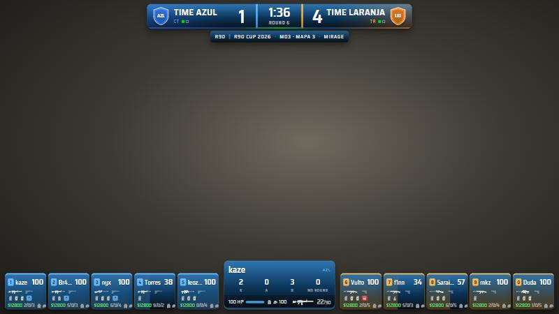
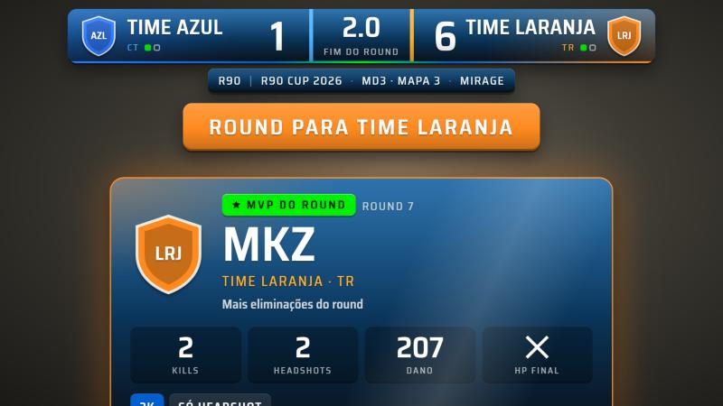
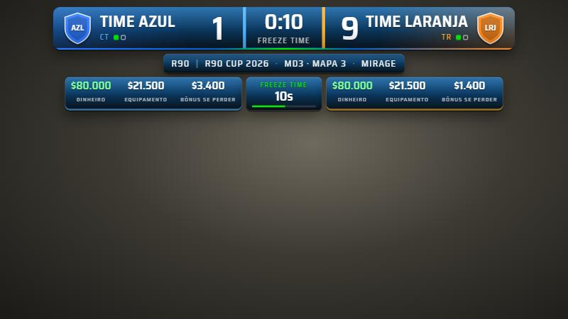
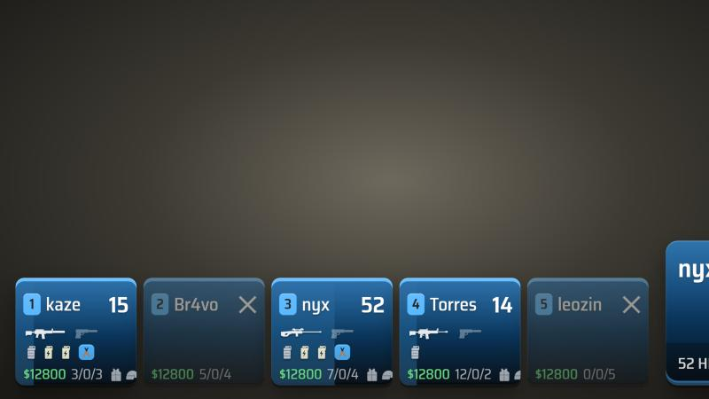
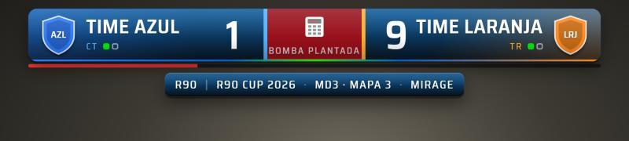
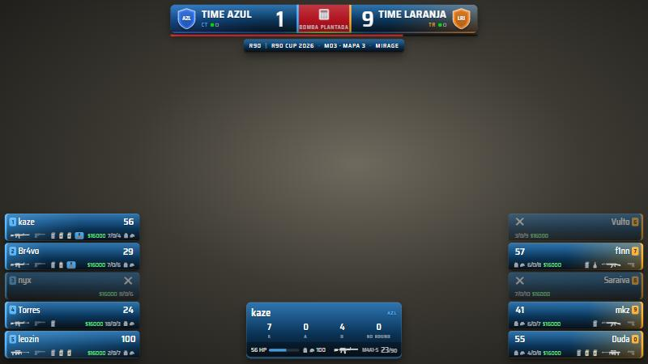
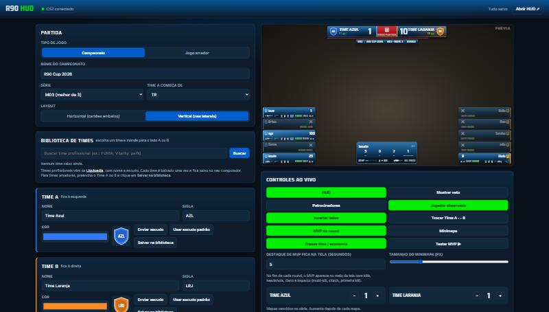

<div align="center">

# R90 HUD

**HUD de transmissão para Counter-Strike 2**

Placar, jogadores, minimapa em tempo real, C4 animada, freeze time com economia, MVP do round, veto de mapas e patrocinadores, tudo controlado por um painel ao vivo.


</div>

> **Código aberto e gratuito.** Pode baixar, usar nas suas lives, alterar e compartilhar à vontade, sob a [licença MIT](LICENSE). Só mantenha o aviso de autoria.



## Destaques

| | |
| --- | --- |
|  |  |
| **MVP do round:** kills, headshots, dano e impacto (multi-kill, clutch, primeira kill). | **Freeze time:** dinheiro, equipamento e bônus de derrota de cada time. |
|  |  |
| **Cartões:** vida, armas (a da mão acesa), granadas, kit, colete, dinheiro e K/A/D. | **C4:** gira enquanto é plantada e fica no lugar do tempo depois de plantada. |





## Recursos

- **Placar:** escudos, lados CT/TR com troca automática (MR12/MR3) e série MD1, MD3 ou MD5.
- **Modo campeonato ou jogo amador:** nome do evento ou selo e texto livre.
- **Dois layouts:** horizontal (cartões embaixo) e vertical (linhas nas laterais).
- **Minimapa em tempo real:** jogadores com direção, C4, smokes, molotovs e mapas de dois andares. Os radares vêm do CS2 instalado no seu PC.
- **Ícones:** armas e itens desenhados no estilo de menu de compra. Dá para usar ícones próprios.
- **MVP do round** detectado direto do jogo.
- **Freeze time** com a economia de cada time.
- **Veto de mapas** com tela própria.
- **Patrocinadores** que trocam sozinhos.
- **Biblioteca de times** com busca de nomes e escudos na Liquipedia.
- **Marca personalizável:** cores, logo, transparência e gradiente.
- **Painel ao vivo** com prévia. Tudo é salvo sozinho.
- **Simulador** para testar sem abrir o jogo.
- **Sem dependências:** só Node.js. Funciona offline, menos a busca de times e as fontes.

## Documentação

| Guia | Conteúdo |
| --- | --- |
| [Instalação](docs/instalacao.md) | Requisitos, servidor, GSI, radares, OBS e simulador |
| [Painel de controle](docs/painel.md) | Cada campo e cada botão do painel |
| [Recursos do HUD](docs/recursos.md) | O que aparece na tela e quando |
| [Minimapa](docs/minimapa.md) | Como os radares são gerados e as coordenadas |
| [Ícones](docs/icones.md) | Ícones de armas e itens, e como usar os seus |
| [Arquitetura](docs/arquitetura.md) | Arquivos, API do servidor, dados do GSI e segurança |
| [Solução de problemas](docs/solucao-de-problemas.md) | Os problemas mais comuns e o que fazer |
| [Changelog](CHANGELOG.md) | Histórico de versões |
| [Avisos legais](AVISOS-LEGAIS.md) | Valve, Liquipedia e fontes |

## Início rápido

Baixe a [última versão](https://github.com/saurorodriguesjunior-dot/r90-hud-cs2/releases/latest) ou clone o repositório:

```bash
git clone https://github.com/saurorodriguesjunior-dot/r90-hud-cs2.git
cd r90-hud-cs2
```

Depois:

```bash
npm start          # liga o servidor: painel em http://localhost:3500/admin.html
npm run radares    # gera os radares do minimapa a partir do seu CS2 (uma vez)
npm run simular    # partida falsa para testar sem o jogo
```

1. Copie `gamestate_integration_r90hud.cfg` para `...\Counter-Strike Global Offensive\game\csgo\cfg` e reinicie o CS2.
2. No OBS, adicione uma fonte de **Navegador** com `http://localhost:3500/hud.html`, em 1920 × 1080.
3. No console do CS2, digite `cl_draw_only_deathnotices 1`.

O passo a passo completo está em [docs/instalacao.md](docs/instalacao.md).

## Como funciona

O CS2 envia o estado da partida pelo **Game State Integration**, o recurso oficial do jogo para isso. O servidor local repassa os dados em tempo real para o HUD e para o painel. Nada é lido da memória do jogo e o anti-cheat não é afetado. Os detalhes estão em [docs/arquitetura.md](docs/arquitetura.md).

## Contribuindo

Sugestões, correções e melhorias são bem-vindas. Abra uma [issue](https://github.com/saurorodriguesjunior-dot/r90-hud-cs2/issues) ou envie um pull request.

## Licença

[MIT](LICENSE) © 2026 [Sauro Rodrigues Jr](https://github.com/saurorodriguesjunior-dot). Livre para usar, copiar, modificar e distribuir, desde que o aviso de autoria seja mantido.

Counter-Strike e CS2 são marcas da Valve Corporation. Este projeto não é afiliado à Valve. Veja os [avisos legais](AVISOS-LEGAIS.md).
